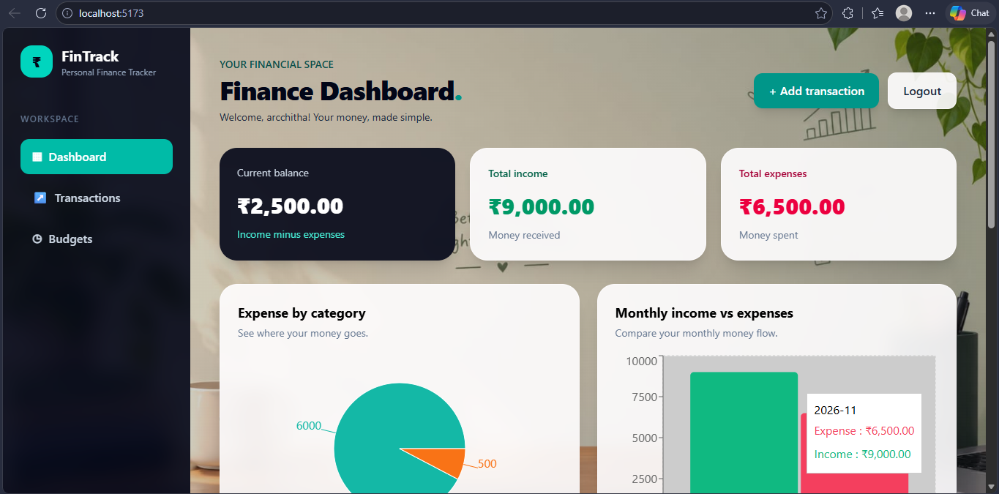

# 💰 Personal Finance Tracker

A full-stack web application that helps users manage their personal finances by tracking income, expenses, and budgets in one place.

## 🚀 Features

- **User Authentication:** Register, log in, and securely manage your account.
- **Dashboard:** View income, expenses, balance, and financial summaries.
- **Transaction Management:** Add, view, edit, and delete transactions.
- **Transaction Filtering:** Filter transactions by income and expense.
- **Budget Management:** Create and manage category-based budgets.
- **Visual Reports:** Understand your financial activity through charts.
- **CSV Export:** Download transaction records as CSV files.
- **Responsive Design:** Use the application on desktop and mobile devices.

## 🛠️ Technologies Used

**Frontend**
- React.js
- Vite
- HTML
- CSS
- JavaScript

**Backend**
- Node.js
- Express.js

**Database**
- MongoDB
- Mongoose

**Authentication**
- JSON Web Tokens (JWT)
- bcryptjs

## 📁 Project Structure

```text
personal-finance-tracker/
│
├── client/
│   ├── public/
│   └── src/
│
├── server/
│   ├── middleware/
│   ├── models/
│   ├── routes/
│   └── server.js
│
├── .gitignore
└── README.md
```

## ⚙️ Installation and Setup

### 1. Clone the repository

```bash
git clone https://github.com/arcchitasreja31-netizen/personal-finance-tracker.git
cd personal-finance-tracker
```

### 2. Install frontend dependencies

```bash
cd client
npm install
```

### 3. Install backend dependencies

Open another terminal:

```bash
cd server
npm install
```

### 4. Configure environment variables

Create a `.env` file inside the `server` folder.

Add your own configuration:

```env
PORT=5000
MONGODB_URI=your_mongodb_connection_string
JWT_SECRET=your_secret_key
```

Never upload your `.env` file or expose database credentials.

### 5. Run the backend

Inside the server folder:

```bash
node server.js
```

### 6. Run the frontend

Inside the client folder:

```bash
npm run dev
```

Open the local URL displayed by Vite in your browser.

## 🎯 Project Objective

The objective of this project is to provide a simple and user-friendly platform for managing personal finances, monitoring spending habits, and organizing budgets.

## 👩‍💻 Developer

**Arcchita Sreja**

GitHub: [@arcchitasreja31-netizen](https://github.com/arcchitasreja31-netizen)

---

⭐ If you find this project useful, consider giving the repository a star!
## 📸 Application Screenshots

### Dashboard


